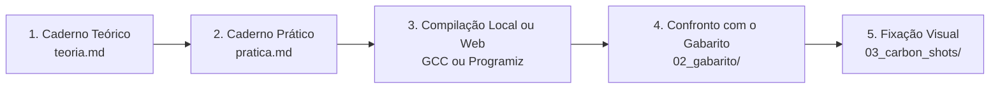

# 🎓 Metodologia Pedagógica dos Exercícios

> *"Ensinar não é transferir conhecimento, mas criar as possibilidades para a sua própria produção ou a sua construção."*  
> — **Paulo Freire**

---

> 🏷️ **Autor & Marca D'água:** Prof. Marcel Florentino "Maçã" • [github.com/applephoria](https://github.com/applephoria)  
> **Tag Oficial:** `github.com/applephoria`

---

## 🎯 Por que esta lista foi concebida?
Esta lista de exercícios foi minuciosamente elaborada pelo **Prof. Marcel Florentino "Maçã"** com base na vivência prática de sala de aula e nas melhores tradições de ciência da computação internacional, espelhando os **Capítulos 1, 2 e 3** do livro canônico:
> **C - Como Programar (6ª Edição)** — *Paul Deitel & Harvey Deitel*

Aqui nós acreditamos na **tríade da fluência em engenharia**:
1. **Teoria de Hardware e Compilação:** Saber o que a CPU e o Sistema Operacional fazem nos bastidores.
2. **Prática Mão na Massa:** Escrever código C puro, sem dependências externas, compilando no terminal.
3. **Rastreamento Mental de Dados:** Conseguir olhar para uma linha de código e visualizar o mapa de memória RAM (endereços, valores e fluxos de controle).

---

## 🧭 Como Estudar Esta Lista



### 📋 Passo a Passo Recomendado:
1. **Responda à Teoria Primeiro (`teoria.md`):** Tente explicar com suas próprias palavras antes de olhar o gabarito. Se você consegue explicar a mecânica de memória para outra pessoa, você dominou o conceito.
2. **Crie seus arquivos `.c`:** Para cada desafio de `pratica.md`, crie uma pasta ou arquivo e escreva o código do zero. Não copie e cole!
3. **Compile no Terminal com Warnings Máximos:**
   ```bash
   gcc -Wall -Wextra -std=c11 ex01.c -o ex01.exe
   ```
4. **Compare com o Gabarito Oficial (`02_gabarito/`):** Veja a solução recomendada, observe o rastro dos dados e leia os comentários de engenharia.
5. **Aprecie a Arte do Código (`03_carbon_shots/`):** Veja como um código limpo ganha vida em cartões visuais para documentação e redes.

---

<div align="center">
  <b>Bons estudos e mãos ao código! 🍏🚀</b><br>
  <b>Tag Oficial de Autoria:</b> <code>github.com/applephoria</code>
</div>
