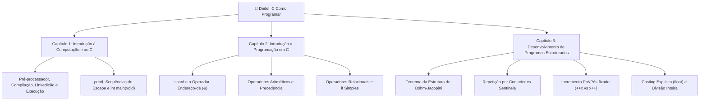

<div align="center">

# 🍏 Mestre em C: Lista de Exercícios & Gabarito Didático
### *Do Silício ao Código Estruturado: Teoria e Prática Baseadas no Livro Deitel*


[](https://github.com/applephoria)


<br/>


<br/>

> *"O C é peculiar, falho e um sucesso estrondoso."*  
> — **Dennis Ritchie**, criador da linguagem C e co-criador do Unix

</div>

---

## 🏛️ O Manifesto do Professor: Paixão pela Licenciatura

> 💡 **"Educar não é encher um balde de informações, mas acender uma fogueira de curiosidade e autonomia."**

Aprender a programar em C não é apenas dominar uma sintaxe; é **compreender a física e a anatomia da computação**. Enquanto muitas linguagens modernas escondem a memória RAM atrás de coletores de lixo (*garbage collectors*), em C você aperta as mãos da CPU, gerencia os bytes na Stack e enxerga os ponteiros nos barramentos do sistema.

Este repositório foi construído por mim, **Marcel Florentino "Maçã"**, reunindo minha paixão pela **Licenciatura em Computação** e meu compromisso com a formação sólida de novos desenvolvedores. Todo o material aqui foi modelado a partir dos **Capítulos 1, 2 e 3** da obra clássica:

📖 **C Como Programar** *(6ª Edição — Paul Deitel & Harvey Deitel)*

---

## 🗺️ Matriz Curricular & Capítulos Estudados



---

## 📂 Arquitetura do Repositório

O repositório foi estruturado de forma modular e intuitiva, separando com clareza o desafio, a resolução em código e o material visual para redes:

```bash
ListaDeExercicios/
│
├── 📁 livro/                       # Material de Apoio Oficial para a Comunidade
│   └── 📕 C - Como Programar [6ª Ed][Deitel & Deitel].pdf
│
├── 📁 01_exercicios/               # Cadernos de Questões (Enunciados Limpos)
│   ├── README.md                   # Metodologia pedagógica de estudos
│   ├── teoria.md                   # 10 Questões Teóricas Desafiadoras (Caps 1, 2 e 3)
│   └── pratica.md                  # 10 Desafios Práticos de Programação em C
│
├── 📁 02_gabarito/                 # Resoluções Oficiais e Explicações
│   ├── teoria_gabarito.md          # Gabarito Teórico com rastro de dados e registradores
│   └── 📁 codigos_c/               # 10 Códigos-Fonte (.c) 100% Compiláveis e Comentados
│       ├── ex01_ola_mundo.c
│       ├── ex02_central_aritmetica.c
│       ├── ex03_maior_menor_tres.c
│       ├── ex04_classificador_par_impar.c
│       ├── ex05_detector_multiplos.c
│       ├── ex06_tabela_quadrados_cubos.c
│       ├── ex07_media_turma_sentinela.c
│       ├── ex08_fatorial_while.c
│       ├── ex09_extremos_sequencia.c
│       └── ex10_calculadora_imc.c
│
├── 📁 03_carbon_shots/             # Galeria Visual de Código (Estilo Carbon)
│   └── README.md                   # Guia de geração visual com assinatura autoral
│
└── README.md                       # O Guia Mestre do Repositório
```

---

## 🛠️ Guia de Instalação e Execução

Você não precisa de um computador potente para programar em C. Você pode rodar tudo **localmente com GCC** ou **100% online direto pelo navegador**, sem instalar nada!

---

### Opção 1: Rodando 100% Online (Zero Instalação) 🌐
Ideal para estudar pelo celular, tablet ou computadores de bibliotecas/laboratórios com permissões bloqueadas:

* 🥇 **[Programiz C Online Compiler](https://www.programiz.com/c-programming/online-compiler/):** **O mais simples e direto ao ponto!** Possui um botão verde gigante **`▶ Run`** no topo. Você cola o código, clica em Run e o terminal abre imediatamente embaixo com suporte total a `scanf` para digitar seus dados.
* 🥈 **[OnlineGDB C Compiler](https://www.onlinegdb.com/online_c_compiler):** **O mais completo para sala de aula!** Também possui o botão verde **`▶ Run`** bem visível na barra superior e uma tela preta de terminal interativa logo abaixo, além de depurador passo a passo.

---

### Opção 2: Configuração Local no Windows (GCC + VS Code) 💻

#### Passo 1: Instalar o Compilador GCC (via MSYS2 / MinGW)
Abra o **PowerShell como Administrador** e execute:
```powershell
# Via WinGet (Gerenciador Oficial do Windows):
winget install -e --id MSYS2.MSYS2
```
Ou baixe diretamente pelo site oficial: [msys2.org](https://www.msys2.org/).  
Após abrir o terminal MSYS2 UCRT64, instale o pacote de ferramentas:
```bash
pacman -S --needed base-devel mingw-w64-ucrt-x86_64-toolchain
```
Adicione o caminho `C:\msys64\ucrt64\bin` às **Variáveis de Ambiente do Sistema (PATH)**.  
Verifique a instalação abrindo um novo terminal e digitando:
```bash
gcc --version
```

#### Passo 2: Configurar o Visual Studio Code
1. Instale o [VS Code](https://code.visualstudio.com/).
2. Abra a aba de Extensões (`Ctrl + Shift + X`) e instale:
   - **C/C++** *(Microsoft)*
   - **Code Runner** *(Jun Han)*
   - **C/C++ Extension Pack** *(Microsoft)*

#### Passo 3: Compilar e Executar no Terminal
Navegue até a pasta do exercício e compile com os avisos máximos de boas práticas de engenharia:
```bash
# Compilação rigorosa com flags do padrão C11
gcc -Wall -Wextra -std=c11 ex01_ola_mundo.c -o ex01_ola_mundo.exe

# Execução no Windows:
.\ex01_ola_mundo.exe

# Execução no Linux / macOS:
./ex01_ola_mundo
```

---

## 📋 Sumário dos 20 Desafios Pedagógicos

### 🧠 10 Questões Teóricas (Conhecimento Profundo)
| # | Tema do Exercício | Cap. Deitel | O que você vai dominar |
| :---: | :--- | :---: | :--- |
| **01** | O Ciclo de Vida do Binário C | Cap. 1 | As 6 fases: Pré-processamento, Compilação, Montagem, Linkedição e Carregamento. |
| **02** | Anatomia de `main(void)` e `return 0` | Cap. 1 e 2 | O diálogo do processo com o Kernel e verificação em scripts corporativos. |
| **03** | Memória RAM e o Mistério do `&` | Cap. 2 | Passagem por valor vs endereço de memória e prevenção de *Segmentation Fault*. |
| **04** | Divisão Inteira, Truncamento e Cast | Cap. 2 e 3 | A física da ALU e conversão unária explícita `(float)` nos registradores. |
| **05** | Precedência e Associatividade | Cap. 2 | Como a CPU avalia expressões e diretrizes de Clean Code contra ambiguidades. |
| **06** | O Operador Módulo (`%`) e Restrições | Cap. 2 | Por que `%` não funciona com números reais e o uso de `fmod()` de `<math.h>`. |
| **07** | O Ponto e Vírgula Indesejado `;` | Cap. 2 e 3 | A armadilha da Instrução Nula (*Null Statement*) em estruturas `if`. |
| **08** | Repetição por Contador vs Sentinela | Cap. 3 | Repetição definida vs indefinida e critérios seguros de valor de parada. |
| **09** | Pré-fixado (`++x`) vs Pós-fixado (`x++`) | Cap. 3 | Efeitos colaterais diferidos na memória e cópia temporária de registradores. |
| **10** | Teorema de Böhm-Jacopini e o `goto` | Cap. 3 | Por que banir o código espaguete e a revolução da Programação Estruturada. |

👉 *Leia as questões completas em: [`01_exercicios/teoria.md`](01_exercicios/teoria.md)*  
👉 *Consulte o gabarito detalhado em: [`02_gabarito/teoria_gabarito.md`](02_gabarito/teoria_gabarito.md)*

---

### 💻 10 Desafios Práticos (Mão na Massa)
| # | Programa / Desafio | Cap. Deitel | Habilidade Trabalhada |
| :---: | :--- | :---: | :--- |
| **01** | Cartão de Visitas de Terminal | Cap. 1 | Sequências de escape `\n`, `\t`, `\"`, `\\` e alerta sonoro `\a`. |
| **02** | Central Aritmética Corporativa | Cap. 2 | Leitura com `scanf`, operadores `+ - * / %` e prevenção de divisão por zero. |
| **03** | Inspetor Relacional de Três Inteiros | Cap. 2 | Comparadores `==`, `!=`, `<`, `>` e algoritmo de extremos com `if` simples. |
| **04** | Classificador de Paridade Numérica | Cap. 2 | Módulo `% 2` e a física do bit menos significativo (LSB) no hardware. |
| **05** | Detector de Múltiplos Matemáticos | Cap. 2 | Relações de divisibilidade com validação defensiva contra divisor nulo. |
| **06** | Tabela de Quadrados e Cubos | Cap. 2 e 3 | Formatação de relatórios em colunas alinhadas com laço `while`. |
| **07** | Sistema de Média com Sentinela `-1` | Cap. 3 | Repetição indefinida com acumuladores e casting de alta precisão `(float)`. |
| **08** | Fatorial Matemático ($N!$) | Cap. 3 | Laço decrescente, acumulador multiplicativo e tipos inteiros longos. |
| **09** | Rastreador de Extremos em Tempo Real | Cap. 3 | Processamento dinâmico de fluxo de dados com complexidade espacial $O(1)$. |
| **10** | Calculadora de IMC Corporativa | Cap. 2 e 3 | Cálculos em ponto flutuante e seleção encadeada com a tabela oficial da OMS. |

👉 *Leia os enunciados práticos em: [`01_exercicios/pratica.md`](01_exercicios/pratica.md)*  
👉 *Acesse os códigos-fonte resolvidos em: [`02_gabarito/codigos_c/`](02_gabarito/codigos_c/)*

---

## 📸 A Galeria Carbon & Identidade Autoral

Para valorizar a didática nas redes sociais e proteger a autoria educacional do material em qualquer lugar da internet, todos os códigos e imagens contêm a marca d'água oficial padronizada:

```c
// ============================================================================
// Autor: Marcel Florentino "Maçã"
// Perfil Oficial & Repositório: github.com/applephoria
// ============================================================================
```

> 🏷️ **Tag Oficial de Autoria:** `github.com/applephoria`

As capturas de tela estilizadas com tema escuro, tipografia Fira Code e controles estilo macOS podem ser visualizadas na pasta:  
👉 **[`03_carbon_shots/`](03_carbon_shots/)**

---

<br/>

#  Tools and references used:

* **Linguagem:** C (Padrão ANSI C / C99 / C11)
* **Compilador:** GNU Compiler Collection (GCC 15.2 via MSYS2 UCRT64)
* **Ambiente de Desenvolvimento:** Visual Studio Code com extensões C/C++ da Microsoft
* **Literatura Principal:** *C Como Programar (6ª Edição)* — Paul Deitel & Harvey Deitel (Pearson Prentice Hall)
* **Design & Visualização:** [Carbon (carbon.now.sh)](https://carbon.now.sh)
* **Plataformas de Execução Web:** [Programiz C Compiler](https://www.programiz.com/c-programming/online-compiler/) & [OnlineGDB](https://www.onlinegdb.com/)

---

<br/>

# 💬 Connect with me

<div align="center">

| Canal | Link Oficial | Descrição |
| :--- | :--- | :--- |
| 🌐 **Hub Central (Beacons)** | [beacons.ai/applephoria](https://beacons.ai/applephoria/aboutme) | Portfólio, projetos e biografia |
| 💼 **LinkedIn** | [linkedin.com/in/marcelflorentino](https://www.linkedin.com/in/marcelflorentino/) | Artigos técnicos e conexões corporativas |
| 📸 **Instagram** | [@applephoria](https://www.instagram.com/applephoria/) | Bastidores de código, design e licenciatura |
| ✉️ **E-mail Profissional** | [eumarcelflorentino@gmail.com](mailto:eumarcelflorentino@gmail.com) | Contato direto para parcerias e palestras |

</div>

---

<div align="center">

> *"Se você não consegue explicar algo de forma simples, você não entendeu suficientemente bem."*  
> — **Albert Einstein**

**Feito com amor, paixão pela docência e café por Marcel Florentino "Maçã" 🍏**  
*Licenciatura em Computação • Pair Programming de Elite*

</div>
